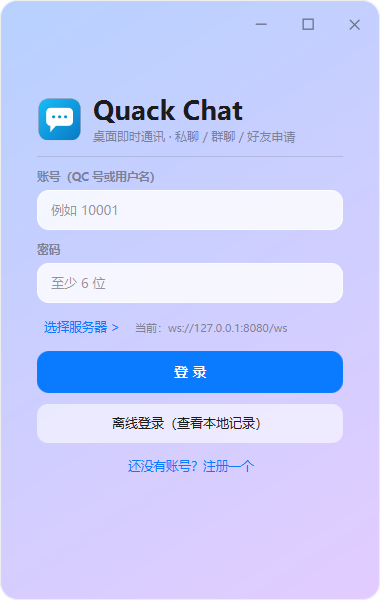
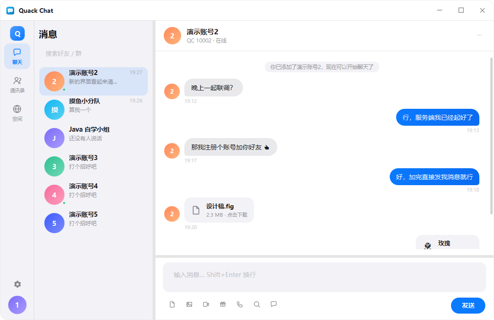
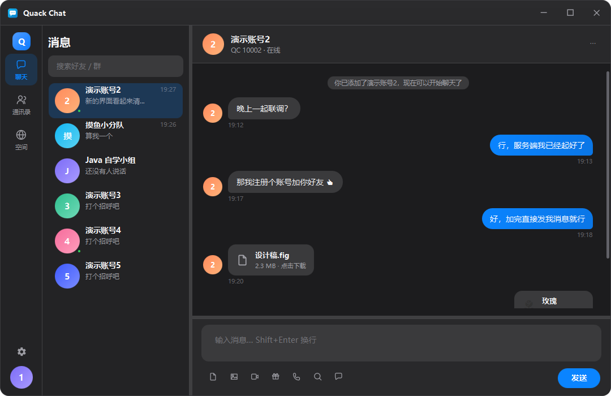

# Quack Chat

Quack Chat 是一个类 QQ 的**桌面即时通讯应用**：JavaFX 桌面客户端 + Spring Boot WebSocket 服务端。

- 每个账号有唯一 **QC 号**（10001 起），每个群有 **群号**（q10001 起）。
- 支持注册登录、好友申请、私聊群聊、图片/文件/视频、语音通话、QC 空间、离线消息、断线重连。
- 客户端和服务端都打包成**双击即用的 exe**，自带 Java 运行时，目标机器不需要装 JDK。
- 界面采用 Apple 风格设计：无边框窗口、圆角与投影、浅色/深色主题、弹簧动效。

<p>
  
  
  
</p>

---

## 目录

- [功能](#功能)
- [快速开始（exe）](#快速开始exe)
- [演示账号](#演示账号)
- [使用说明](#使用说明)
- [从源码运行与打包](#从源码运行与打包)
- [技术架构](#技术架构)
- [数据与存储](#数据与存储)
- [配置与部署](#配置与部署)
- [测试与验证](#测试与验证)
- [项目结构](#项目结构)
- [已知限制](#已知限制)
- [常见问题](#常见问题)
- [最近更新](#最近更新)

---

## 功能

### 账号与好友

| 功能 | 说明 |
|---|---|
| 注册 / 登录 | 注册只填用户名 + 密码，QC 号由系统分配；支持 QC 号或用户名登录 |
| 账号切换 | 同一台设备可保存多个账号，左下角头像 →「切换账号」 |
| 离线登录 | 登录过一次的账号，服务端不可达时可用本机密码校验进入只读模式 |
| 用户搜索 | 按 QC 号或用户名搜索，QC 号精确命中优先 |
| 好友申请 | 验证消息 + 备注；对方同意后才成为好友，支持同意/拒绝 |
| 新的朋友 | 通讯录顶部入口，带未读角标和实时推送 |
| 好友备注 | 只影响自己这一侧显示；多端同步 |
| 通讯录 | 好友/群分组、头像、在线状态、搜索过滤 |

### 聊天

| 功能 | 说明 |
|---|---|
| 私聊 / 群聊 | 乐观上屏 → 服务端 ACK 后把「发送中」变成时间戳 |
| 消息类型 | 文本、表情、图片、文件、视频、礼物 |
| 图片 / 视频 | 上传走 HTTP + Bearer token；图片气泡内预览，视频显示封面和时长，点击交给系统播放器 |
| 文件 | 最多 300MB，签名 URL 下载；默认保存/选择目录为系统「图片」 |
| 已读回执 | 私聊「已送达 / 已读」，群聊显示「已读 N」 |
| 正在输入 | 对方标题栏显示「xxx 正在输入…」 |
| 消息撤回 | 自己 2 分钟内的消息可撤回，多端和历史记录同步 |
| 消息编辑 | 自己的文本消息可编辑，推送多端 |
| 查找记录 | 关键字 + 群成员筛选，图片/视频/文件显示占位标签，可定位到消息 |
| 会话操作 | 置顶、免打扰、隐藏、标为已读、删除记录 |
| 离线消息 | 离线入箱，下次登录自动补发 |
| 多端 | 同一账号多设备并存，每设备独立离线游标；同 deviceId 重登才踢旧连接 |

### 群聊

| 功能 | 说明 |
|---|---|
| 创建群聊 | 通讯录最上方「创建群聊」→ 填群名 → 勾选好友 → 创建；建群者自动成为群主，成员实时收到新群 |
| 加群审批 | 搜索群号/群名提交申请；群主/管理员在「待处理」里同意或拒绝 |
| 群资料 | 群号、成员九宫格、群公告、群头像、群昵称、群文件/相册/闪传 |
| @ 提及 | 群聊输入 `@` 选择所有人或成员；会话列表预览显示「[有人@我]」 |
| 群管理 | 邀请、移出、任命/取消管理员、转让群主、解散群聊 |
| 群公告 | 多条公告，新公告弹窗提醒 |
| 精华消息 | 群主/管理员把消息设为精华，群资料页查看/移除 |
| 快捷短语 | 群快捷栏点一条直接插入输入框 |
| 群提示音 | 群设置里单独开关（本机偏好） |

### 空间与通话

| 功能 | 说明 |
|---|---|
| QC 空间 | 好友动态流 / 个人空间；文字 + 最多 9 图或 1 个视频 |
| 互动 | 点赞（可取消）、评论、删除、分页；点赞/评论通知 |
| 语音通话 | 信令 + 真实音频：16k/16bit 单声道 PCM 经服务端中继，支持静音、挂断、群内多人接听 |
| 视频通话 | 暂不支持（视频只作为聊天/空间消息） |

### 客户端体验

| 功能 | 说明 |
|---|---|
| 无边框窗口 | 自绘标题栏、最小化/最大化/关闭、圆角投影、双击最大化 |
| 八向缩放 | 四条边 + 四个角拖拽缩放，受最小尺寸约束 |
| 窗口记忆 | 位置、大小、最大化状态下次启动还原；离屏时自动拉回屏幕 |
| 自适应布局 | 侧栏按窗口宽度伸缩，气泡宽度跟随聊天区，文字自动省略 |
| 浅色 / 深色 | 支持跟随系统；主窗口、聊天页、弹窗统一换肤 |
| 界面字号 | 小/标准/大/超大，立即生效 |
| 减少动效 | 关闭弹簧/淡入动效 |
| 图片加载优化 | 内存 LRU 缓存 + 服务端缩略图；头像上传前本地裁成 256×256 |
| 顶部提示 | 错误/普通提示统一 2 秒后淡出；Toast 同样自动消失 |
| 文件选择 | 图片/文件/视频/头像/另存图片默认从系统「图片」目录开始 |

---

## 快速开始（exe）

发布产物在 `dist/`：

```
dist/
├── QuackChat/
│   └── QuackChat.exe          # 客户端
├── QuackChatServer/
│   └── QuackChatServer.exe    # 服务端
└── start-chat.bat             # 一键启动服务端 + 客户端
```

### 1. 启动服务端

双击 `dist/QuackChatServer/QuackChatServer.exe`。

- 默认监听 `0.0.0.0:8080`，WebSocket 地址 `ws://127.0.0.1:8080/ws`。
- 数据目录在 exe 旁边的 `data/`（首次启动自动创建并写入演示数据）。
- 健康检查：`http://127.0.0.1:8080/healthz`。
- 局域网/公网访问要放行 TCP 8080：

```powershell
netsh advfirewall firewall add rule name="QuackChat 8080" dir=in action=allow protocol=TCP localport=8080
```

### 2. 启动客户端

双击 `dist/QuackChat/QuackChat.exe`。

在登录页填写：

- 服务器：本机 `ws://127.0.0.1:8080/ws`；远程换成 `ws://服务器IP:8080/ws` 或 `wss://域名/ws`
- 账号：`10001`（或 `演示账号1`）
- 密码：`123456`

想演示互聊，把客户端再开一个窗口，登录另一个账号即可。

### 3. 重置演示数据

先停掉服务端，再删除：

```
dist/QuackChatServer/data
```

重新启动服务端会重新写入 15 个演示账号、好友关系和 2 个演示群。

客户端本机缓存（账号列表、本地消息、窗口状态）在：

```
dist/QuackChat/data
```

想完全恢复到“第一次打开”的状态，把客户端关掉后一并删除。

---

## 演示账号

首次启动且数据库为空时自动写入：

| QC 号 | 用户名 | 密码 | 说明 |
|---|---|---|---|
| 10001 | 演示账号1 | 123456 | q10001「摸鱼小分队」群主，q10002 成员 |
| 10002 | 演示账号2 | 123456 | q10002「Java 自学小组」群主 |
| 10003 | 演示账号3 | 123456 | q10001 成员 |
| 10004 ~ 10014 | 演示账号4 ~ 14 | 123456 | q10001 成员 |
| 10015 | 演示账号15 | 123456 | q10001 成员 |

- 15 个演示账号**互为好友**，可直接私聊、建群、通话。
- `q10001 摸鱼小分队`：15 人，群主 10001。
- `q10002 Java 自学小组`：8 人（演示账号 1～8），群主 10002。
- 演示账号默认没有头像，会显示首字母/渐变占位；录制或截图前可以先各自上传头像。

> 演示数据只在 `userService.count() == 0` 时写入。已有数据不会覆盖。

---

## 使用说明

### 加好友

1. 通讯录 →「新的朋友」右侧 `＋`。
2. 输入对方 QC 号或用户名搜索。
3. 点「添加」填写验证消息和备注。
4. 对方在「新的朋友」里同意后，双方好友关系和会话自动出现。

### 创建群聊

1. 通讯录最上方「创建群聊」。
2. 填写群名（1～20 字）。
3. 勾选要拉进来的好友（只能拉好友）。
4. 点「创建群聊」。建群者成为群主，所有成员实时收到新群。

### 群管理

打开群聊 → 双击群名或右键会话「详细信息」：

- 改群名、群头像、群公告
- 邀请成员、移出成员
- 任命/取消管理员、转让群主
- 群主可解散群聊
- 成员可设置我在本群的昵称、退群

### 发消息

输入区从左到右：

- `📎` 选择文件
- `🖼` 选择图片
- `🎬` 选择视频
- `🎁` 发送礼物
- `📞` 发起语音通话

右键消息可撤回、设为精华（群主/管理员）、复制等；群聊输入 `@` 选择提及对象。

### QC 空间

- 个人主页（双击聊天标题或右键会话「查看资料」）进入 QC 空间。
- 发文字 + 最多 9 图或 1 个视频。
- 好友动态流可点赞、评论；点赞/评论会通知作者。

### 设置

左下角头像 →「账号与设置」：

- 通用：浅色 / 深色 / 跟随系统、减少动效、消息提示音、界面字号、下载行为
- 切换账号、添加账号、退出登录

### 窗口

- 拖动标题栏移动。
- 拖四条边/四个角缩放。
- 双击标题栏最大化/还原。
- 关闭后下次启动恢复上次位置和大小。

---

## 从源码运行与打包

需要 **JDK 17+**（推荐 JDK 21，包含 `jpackage`）和 **Maven 3.6+**。

### 从源码运行

```powershell
# 首次先安装三个模块到本地仓库
mvn -q -DskipTests install

# 终端 1：启动服务端（8080）
mvn -q -pl chat-server spring-boot:run

# 终端 2：启动客户端（可以再开一个窗口登录另一个账号）
mvn -q -pl chat-client javafx:run
```

也可以直接双击 `scripts/start-server.bat` / `scripts/start-client.bat`（同样需要先 `mvn install`）。

### 重新打包 exe

在 Windows 上执行（脚本会自动跑 Maven 构建，再调用 `jpackage`）：

```powershell
powershell -ExecutionPolicy Bypass -File packaging\build-exe.ps1 `
  -JdkPath "C:\path\to\jdk-21" `
  -MvnPath "C:\path\to\mvn.cmd"
```

输出：

```
dist\QuackChat\QuackChat.exe
dist\QuackChatServer\QuackChatServer.exe
```

打包脚本会调用 `jpackage` 生成 app-image，自带 Java 运行时；目标机器不需要安装 JDK。

---

## 技术架构

```
JavaFX 客户端  ── WebSocket / JSON ──▶  Spring Boot 服务端  ── JDBC ──▶  SQLite（quack.db）
      │                                        │
      └──── HTTP 上传 / 下载 / 缩略图 ──────────┘
```

| 模块 | 内容 |
|---|---|
| `chat-common` | 协议信封、命令字、DTO、数据模型、数据目录工具；两端共用 |
| `chat-server` | WebSocket 接入、`dispatch` 分发、`service` 业务、SQLite 持久化、HTTP 文件接口 |
| `chat-client` | JavaFX UI、`store` 状态与本地 SQLite、`net` WebSocket/HTTP、`media` 音频与视频 |
| `packaging` | jpackage 打包脚本、界面探针、离屏截图工具 |
| `scripts` | 端到端测试、开发启动脚本 |

- **协议**：`{cmd, seq, code, msg, data}` JSON 信封；请求按 `seq` 配对，推送 `seq=0`。完整命令表见 [`docs/protocol.md`](docs/protocol.md)。
- **分层/取舍**：见 [`docs/architecture.md`](docs/architecture.md)。
- **安全**：登录 token + Bearer 鉴权；文件 URL 带 HMAC 签名和过期时间；密码只存 PBKDF2 哈希；登录限流；上传路径校验。没有端到端加密，服务端可读取消息内容。

### 技术栈

| 层 | 选型 |
|---|---|
| 语言 | Java 17（源码级别，构建/运行使用 JDK 21） |
| 桌面 UI | JavaFX 21（controls / graphics / media）+ JavaFX CSS |
| 服务端 | Spring Boot 3.2.5（Spring Web + WebSocket，内嵌 Tomcat） |
| 通信 | WebSocket + JSON 信封；HTTP 文件上传/下载 |
| 存储 | SQLite（sqlite-jdbc 3.45.3.0，WAL） |
| JSON | Jackson 2.15.4 |
| 其他 | pinyin4j（拼音分组）、Java Sound API（语音）、AWT SystemTray（托盘） |
| 构建/打包 | Maven 3.10 多模块 + JDK `jpackage`（app-image） |
| 测试 | Node 端到端脚本 + JavaFX 控件/窗口探针 |

---

## 数据与存储

### 服务端

```
data/
├── quack.db          # SQLite 主库
├── files/            # 上传的图片/文件/视频（7 天清理）
├── thumbs/           # 按宽度生成的缩略图缓存
└── tls/              # 可选：TLS keystore
```

主要表：

| 表 | 内容 |
|---|---|
| `accounts` | 账号，密码只存哈希 |
| `profiles` | 头像、签名、性别、生日、地区、身份、赞 |
| `friendships` | 好友关系 + 单向备注 |
| `friend_requests` | 好友申请（含备注） |
| `groups` / `group_members` | 群信息、群主、公告、群头像、成员 |
| `messages` | 全部聊天消息，含发送者头像快照 |
| `read_state` | 每个会话里每个人的已读时间点 |
| `meta` | QC 号 / 群号的自增序列 |

写入策略：元数据每 2 秒比对一次快照指纹，有变化就在一个事务里重写；消息表只追加，每个会话有唯一 `(conv_key, seq)`，不随历史增长重写整表。退出时再补一次。

### 客户端

- `data/local/<QC号>.db`：每个账号独立的本地 SQLite，缓存会话、消息、草稿、已读游标；每会话最多读 3000 条。
- `data/window.properties`：窗口位置/大小/最大化状态。
- 打开会话先渲染本地缓存，再按 `seq` 同步服务端缺口；离线登录时只读本地。

### 备份

先停服务端，再复制 `data/quack.db`（连同同名 `-wal` / `-shm` 一起复制更稳妥）。附件在 `data/files/`。

---

## 配置与部署

### 换端口

```powershell
QuackChatServer.exe --server.port=9090
```

客户端服务器填 `ws://服务器IP:9090/ws`。

### 公网部署（Nginx 反代 + TLS）

建议客户端只连 Nginx，由 Nginx 转发 WebSocket 和 HTTP：

```nginx
server {
    listen 80;
    server_name chat.example.com;
    client_max_body_size 320m;

    location /ws {
        proxy_pass http://127.0.0.1:8080;
        proxy_http_version 1.1;
        proxy_set_header Upgrade $http_upgrade;
        proxy_set_header Connection "upgrade";
        proxy_read_timeout 3600s;
    }

    location / {
        proxy_pass http://127.0.0.1:8080;
        proxy_set_header Host $host;
        proxy_set_header X-Real-IP $remote_addr;
    }
}
```

配置证书后客户端填 `wss://chat.example.com/ws`。

也可以直接用服务端内置 TLS：

```powershell
keytool -genkeypair -alias quack -keyalg RSA -keysize 2048 -validity 365 `
  -storetype PKCS12 -keystore data/tls/quack.p12 -storepass changeit `
  -dname "CN=your.domain"

QuackChatServer.exe --spring.profiles.active=tls
```

相关环境变量：`QUACK_TLS_KEYSTORE`、`QUACK_TLS_PASSWORD`、`QUACK_TLS_ALIAS`。

### 后台常驻

Windows 可以用 NSSM：

```powershell
nssm install QuackChatServer "C:\path\to\QuackChatServer.exe"
nssm start QuackChatServer
```

---

## 测试与验证

### 端到端

需要 Node 18+。服务端用全新数据目录启动，避免旧数据影响：

```powershell
java "-Dquack.data.dir=E:\tmp\quack-e2e" `
  -jar chat-server/target/chat-server-1.0.0-SNAPSHOT.jar `
  --server.port=18080

node scripts/e2e-apple.mjs ws://127.0.0.1:18080/ws
```

当前脚本共 **66 项检查**，覆盖：注册登录、QC 号、好友申请/备注、私聊/群聊、图片/文件上传、已读、撤回、@、离线消息、多端、通话信令、建群、群管理、资料、空间、文件接口、权限等。

### 界面与协议探针

源码在 `packaging/`，覆盖真实 JavaFX 窗口、控件断言和截图：

| 探针 | 检查点 |
|---|---|
| `AppleUiProbe` | 27 项：登录页、主界面、弹窗、主题、动效、Toast、创建群聊、发消息 |
| `LoginDragProbe` | 5 项：登录页拖动 |
| `SplitDebug` | 13 项：输入区拖拽/边界 |
| `LayoutProbe` | 9 项：窗口缩放与布局 |
| `AvatarSyncProbe` | 10 项：头像跨客户端同步、群头像、历史消息头像 |
| `AvatarListProbe` | 2 项：通讯录头像、好友申请头像 |
| `ImagePerfProbe` | 5 项：图片缓存、缩略图参数、头像裁剪 |

完整功能矩阵见 [`docs/feature-checklist.md`](docs/feature-checklist.md)。

### 截图

`packaging/AppleSnapshot.java` 离屏渲染登录页、主界面、深色主题和演示群，输出到 `docs/screenshots/apple/`。

---

## 项目结构

```
quack-chat/
├── pom.xml                     # Maven 多模块
├── chat-common/                # 协议、DTO、模型、工具（两端共用）
├── chat-server/                # Spring Boot 服务端
│   └── src/main/java/io/quack/server/
│       ├── ws/                 # WebSocket 接入
│       ├── dispatch/           # 命令分发 + handler
│       ├── service/            # 业务服务
│       ├── store/              # SQLite / 内存存储
│       └── web/                # 文件上传、下载、健康检查
├── chat-client/                # JavaFX 客户端
│   └── src/main/java/io/quack/client/
│       ├── ui/                 # 界面、弹窗、动效
│       ├── store/              # ClientStore、本地 SQLite
│       ├── net/                # WebSocket、HTTP、图片缓存
│       └── media/              # 语音、视频、图片处理
├── packaging/                  # jpackage 打包 + 界面探针 + 截图
├── scripts/                    # e2e、启动脚本
├── docs/                       # 协议、架构、功能清单、截图
└── dist/                       # 打包产物（生成）
```

---

## 已知限制

- 视频通话暂不支持；语音通话是 16k/16bit 单声道中继，适合演示/小团队，不适合大规模会议。
- SQLite 单机存储；元数据每 2 秒全量快照，数据量很大时会出现周期性磁盘写入。
- 没有端到端加密；服务端能看到消息内容，适合学习/内部演示，不建议直接承载敏感业务。
- 上传文件默认保留 7 天，过期自动清理。
- 没有找回密码功能；演示账号密码固定 `123456`。
- exe 目前只提供 Windows 构建；源码可在其他平台运行，但需要自行打包。

---

## 常见问题

**客户端一直显示“连接中/重连”？**

1. 确认服务端已启动，浏览器打开 `http://127.0.0.1:8080/healthz` 应返回 200。
2. 远程部署确认服务器防火墙/安全组已放行 8080，客户端填的是 `ws://服务器IP:8080/ws`。
3. 如果走 Nginx，确认 `/ws` 配了 `Upgrade` / `Connection` 和足够的 `proxy_read_timeout`。

**端口 8080 被占用？**

```powershell
netstat -ano | findstr :8080
```

结束占用进程，或给服务端换端口 `--server.port=9090`。

**登录提示“账号已在别处登录”/被踢下线？**

同一账号用同一个 `deviceId` 重复登录会踢掉旧连接（关闭码 4001）。换设备/换客户端窗口登录即可；不同 deviceId 可以多端共存。

**想清空所有聊天记录和演示账号？**

停服务端 → 删除 `dist/QuackChatServer/data` → 重启。想连客户端本地缓存一起清，再删 `dist/QuackChat/data`。

**图片加载慢？**

确认客户端和服务端都是最新版本：头像/图片会请求 `?w=` 缩略图并做内存缓存，首次加载后再次打开会明显变快。远程部署慢通常是上行带宽或服务器出网带宽不足，可以把 `files/` 放到对象存储/CDN。

**视频打不开？**

视频交给系统默认播放器；HEVC 等编码取决于系统解码器。建议用 H.264 + AAC 的 MP4。

**双击 exe 没反应/还是旧界面？**

任务管理器里结束残留的 `QuackChat.exe` / `QuackChatServer.exe` 后重新启动；确认 `dist` 是最近一次打包产物。

---

## 最近更新

- **Apple 风格界面**：设计令牌、浅色/深色、弹簧动效、无边框窗口与八向缩放。
- **创建群聊**：通讯录顶部入口，选好友建群，成员实时收到新群。
- **头像同步**：好友/自己改头像后，会话列表、聊天头部、历史消息、通讯录、好友申请同步更新。
- **图片性能**：上传头像裁剪 256×256、服务端缩略图、客户端 LRU 缓存、HTTP 缓存头。
- **交互修复**：顶部错误提示与 Toast 2 秒自动淡出；文件选择框默认系统「图片」目录。
