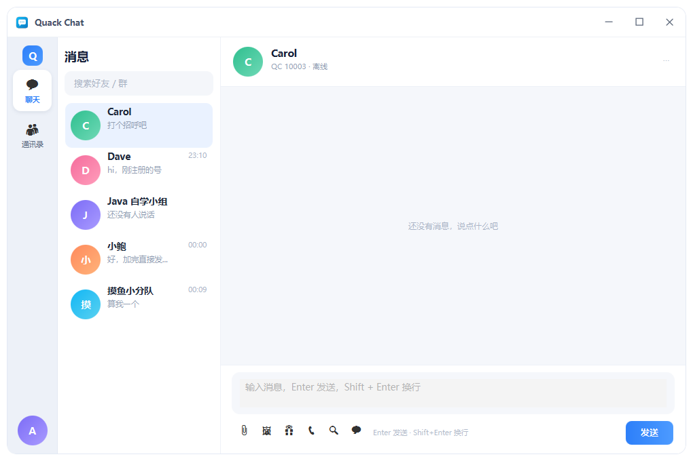
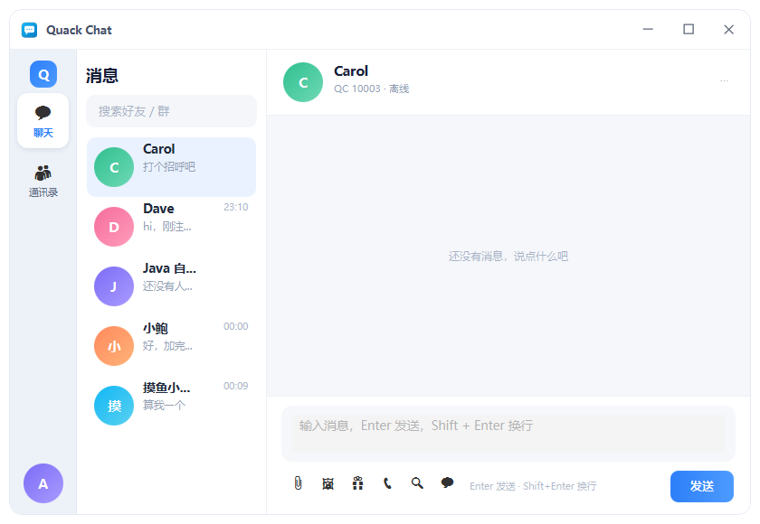
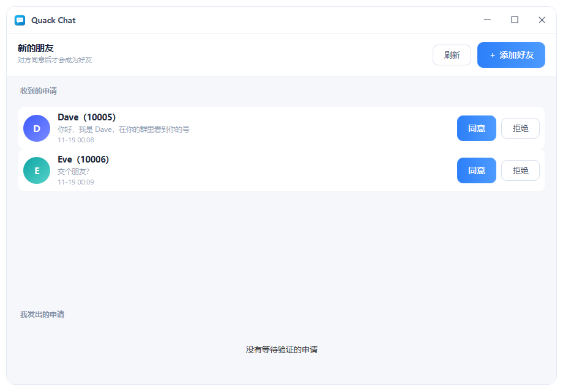
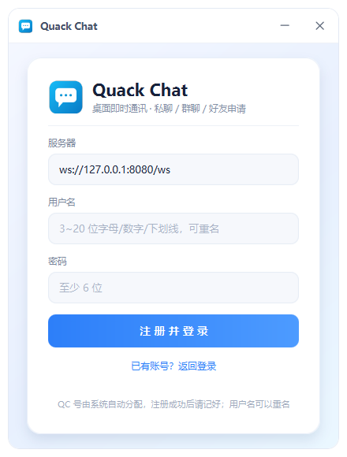
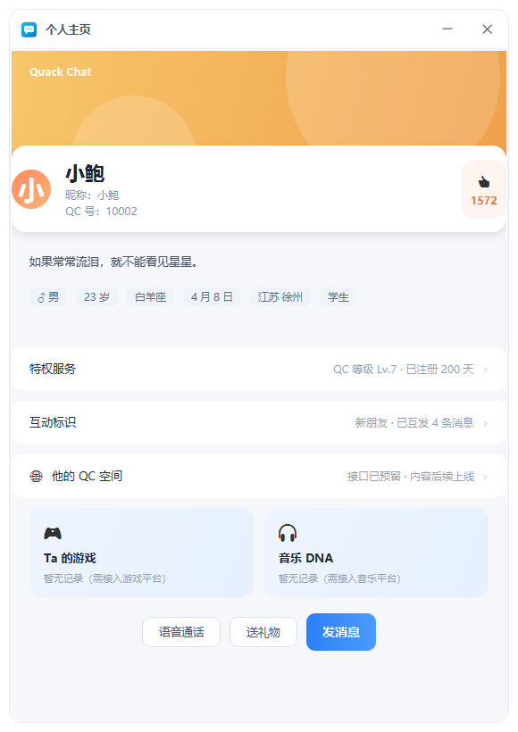
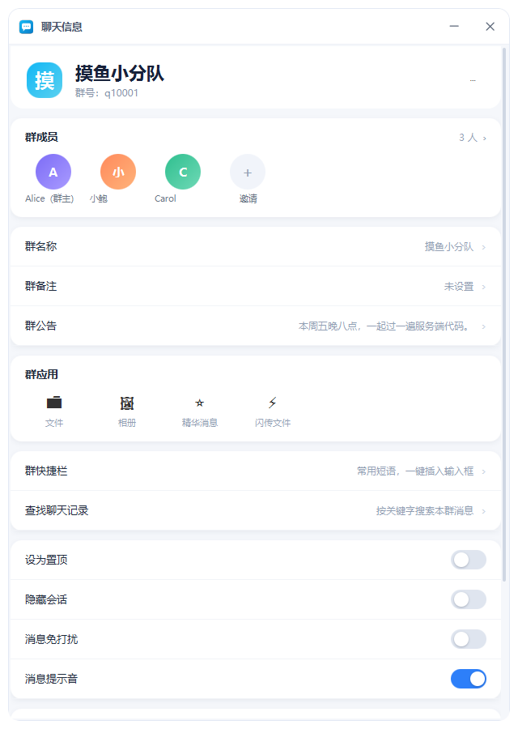

# Quack Chat

> 一个类 QQ 的桌面即时通讯软件：**JavaFX 桌面端 + Spring Boot WebSocket 服务端**。
> 每个账号有唯一 **QC 号**（从 10001 起，10001 是测试号），每个群有 **群号**（从 q10001 起）；
> 支持按 QC 号/用户名搜索、好友申请与审批、注册登录、私聊群聊、离线消息、断线重连，
> 并且打包成了**双击就能跑的 .exe**（自带 Java 运行时，目标机器不需要装 JDK）。




左侧是导航栏（聊天 / 通讯录），中间是列表，右侧是内容区；输入区可以直接发文件、图片、礼物，也能发起通话、查找记录：

窗口是**无边框**的：自绘标题栏、圆角投影、八向拖拽缩放、双击最大化，位置和大小会记住。
布局随窗口自适应（侧栏按比例伸缩，气泡最大宽度跟随聊天区，不会出现横向滚动条）：



好友申请管理：通讯录最上方是「新的朋友」，有红色角标，同意后才成为好友：



注册页只允许填**用户名 + 密码**，QC 号由系统分配（10001 起），界面上没有任何编辑入口：



个人主页（双击聊天标题或右键会话「查看资料」打开；QC 空间入口在这里）：



群主页（双击群名或右键会话「详细信息」打开；成员、公告、开关、退群都可用）：



## 持久化（SQLite，重启不丢数据）

服务端状态存进 `data/quack.db`（SQLite 单文件，服务端 exe 旁边，**不需要安装数据库**）。

真实表结构：

| 表 | 内容 |
|---|---|
| `accounts` | 账号，密码只存哈希 |
| `profiles` | 个人资料（头像、签名、性别、生日、地区、身份、赞） |
| `friendships` | 好友关系 + 单向备注，主键 `(a, b)` |
| `friend_requests` | 好友申请（含申请时填的备注） |
| `groups` / `group_members` | 群信息、群主、公告、群头像、成员 |
| `messages` | 全部聊天消息（含发送者头像快照） |
| `read_state` | 每个会话里每个人的已读时间点 |
| `meta` | QC 号 / 群号的自增序列 |

写入策略：元数据（账号/资料/好友/群/已读/离线游标）每 2 秒比一次快照指纹，有变化就在**一个事务**里清表重写；
**消息表只追加**——每个会话有唯一 `(conv_key, seq)`，每次只插入还没写过的消息，不再随历史增长重写整表。
断电也不会写坏，退出时再补一次。数据量小（演示/小团队）时这样最不容易漏表。

验证（`perf/PersistProbe.java` + `perf/DbDumpProbe.java`，打包后的 exe 也跑过）：

```
PASS 写入消息 / 写入个性签名 / 写入好友备注
PASS 重启后好友备注还在 / 个性签名还在 / 聊天记录还在
PERSIST OK
TABLE accounts = 3 / profiles = 3 / friendships = 6 / groups = 2 / group_members = 5 / messages = 1
DB OK
```

备份：**先停服务端**，再复制 `data\quack.db`（还有同名 `-wal` / `-shm` 文件一起复制更稳妥）。
## 部署（公网服务器）

1. 复制整个 `QuackChatServer` 目录，运行 `QuackChatServer.exe`（自带 JRE）
2. 放行入站 TCP 8080：`netsh advfirewall firewall add rule name="QuackChat 8080" dir=in action=allow protocol=TCP localport=8080`；云服务器还要开安全组
3. 客户端「服务器」填 `ws://公网IP:8080/ws`
4. 数据在 `QuackChatServer\data\`：`state.json`（业务数据）、`files`（上传文件，7 天清理）
5. 换端口：`QuackChatServer.exe --server.port=9090`；后台常驻：`nssm install QuackChatServer <exe 路径>`

## 窗口控制（最小化 / 最大化 / 关闭）

三个按钮之前"点了没反应"，是四个问题叠在一起：

1. **拖动逻辑吞掉了点击**：`WindowDrag` 在 `MOUSE_RELEASED` 里无条件把窗口移到 `pending`，
   而 `pending` 初始是 (0,0)——点一下标题栏/按钮，窗口直接跳到左上角
2. **最大化被开关挡住**：`toggleMaximize()` 里有 `if (!maximizable) return;`，
   而窗口是按登录页参数 `maximizable=false` 创建的，登录后也没打开
3. **弹窗没接最小化**：`ModalShell` 只接了关闭
4. **登录页少了最大化按钮**

现在：

- 拖动只在"真的拖动过"（位移 > 0）时才移动窗口；点在按钮上不启动拖动
- 三个动作统一走 `AppWindow`：`stage.setIconified(true)` / `toggleMaximize()` / `stage.close()`
- 登录成功后 `setMaximizable(true)`，主窗口恢复最大化按钮
- 所有 `ModalShell` 弹窗都有最小化 + 最大化 + 关闭（窗口控制统一走 `ModalShell.toggleMaximize`）
- 登录卡片右上角：— □ ✕，按钮热区 26×22

验证（`perf/WindowControlsProbe.java`、`perf/LoginChromeProbe.java`）：

```
PASS 最小化（isIconified=true）
PASS 最大化（2560 vs 屏幕 2560）
PASS 还原（宽=360）
PASS 关闭（isShowing=false）
WINDOWCONTROLS OK / LOGINCHROME OK
```

## 备注显示 / 编辑资料 / 已读回执 / @提及

- **备注同步到资料页**：别人的主页标题优先显示你给他的备注，没有备注才用对方昵称
- **编辑资料滚动了**：弹窗改成 520×720 + ScrollPane，字段再多也不会被截断
- **私聊已读**：打开会话/收到消息时上报 `msg.read`，服务端记录并推 `msg.read.push`；
  自己最后一条消息下面显示「已读 / 未读」
- **群聊已读人数**：同一条最后消息显示「已读 N」（N = 已读到该消息的群成员数）
- **@ 提及**：群聊输入 `@` 立即弹出「所有人 + 群成员」（修复了按下 @ 时 textProperty 早于光标更新、
  导致要再打一个字才出现的 off-by-one），继续输入会过滤，点选插入 `@名字 `；
  被 @ 或 @所有人 时，会话列表该群预览显示 `[有人@你]`，进入会话后清除

验证：

```
PASS 双方登录 / 消息已发送 / 对方收到消息 / 发送方收到已读通知
READ OK
```

## 头像来源统一 / 备注昵称 / 群通话多人接听

- **头像统一从服务端来**：`GroupMember` 和 `ChatMessage` 都带上 `avatar` 字段，
  群成员列表、消息气泡、会话列表、聊天头部、个人主页全部渲染真实头像（没有才用首字母占位）
- **自己主页头像**：服务端资料优先，缺失时回退本地身份，避免刚上传完看不到
- **自己 / 别人的主页分开**：自己的显示「编辑资料」；别人的显示「设置备注」
- **好友备注（昵称）**：新增 `friend.remark` 命令，备注只影响自己这一侧显示，
  重新登录也保留（`FriendService.remarks`）；多端通过 `friend.remark.push` 同步
- **加好友时设置昵称**：搜索结果里点「加好友」后弹出确认窗口，在确认窗口填写备注（不显示在主搜索页），留空则默认显示对方用户名；已是好友/自己会直接标记，不能再发申请
- **群通话多人接听**：发起群通话会呼叫所有在线群成员，多人可同时接听；
  服务端维护参与者列表并通过 `call.participants` 推送，通话弹窗里用头像墙显示已接听的人；
  音频转发给所有已接听者（非混音，局域网级）

验证：

```
GROUPCALL OK   三人上线 → 发起 → 两人收到来电 → 都接听 → 参与者 3 人 → 挂断全员收到
REMARK OK      设置备注 → 保存成功 → 重新登录好友列表显示备注
OWNPROFILE OK  user.update 返回新头像，user.profile 能读回
```

## 群头像圆框 / 用户名与昵称 / 群资料同步 / 消息排序与未读角标

- **群头像不留方框**：图片已经裁成圆形，但标签本身还带着样式表里的方形底色/边框；显示图片时把背景、
  边框、阴影全部置为透明，只剩一个干净的圆
- **用户名与昵称合并**：个人信息里只保留「用户名」；昵称作为「显示名」默认等于用户名，
  改用户名时未单独设置过的昵称会一起更新（服务端逻辑）
- **群主改完自己看不到**：`updateGroup` 成功回调里没有更新本地会话数据；现在会同步会话标题/头像并刷新列表与头部
- **新消息冒泡 + 未读角标**：会话排序改为「置顶 → 最后消息时间倒序」；未读数改成红底白字的圆形角标，
  叠在头像右上角
- 顺带修了窗口变窄时输入区按钮和「发送」被压成省略号的问题

视觉验证（`perf/VisualProbe.java` 截图）：群头像为纯圆无框、未读角标在头像右上角、工具栏图标完整。

## 群头像保存 / 聊天头部头像同步

- **群头像保存没反应**：`GroupUpdateHandler` 调的是三参数 `update(...)`，`req.avatar()` 被丢掉了，
  服务端根本没存；补上后又验证了 `group.update` → `group.detail` 能读回新头像
- **群资料变更推送**：新增 `group.updated.push`，群名/公告/头像变了会推给其他成员，
  会话列表和聊天头部一起刷新
- **列表变了但里面没变**：`refreshConversations()` 只 `refresh()` 了列表，没刷新聊天头部；
  现在同时调用 `chatPane.refreshHeader()`

回归测试：

```
PASS group.update 返回了新群头像
PASS group.detail 里能读到新群头像      GROUPAVATAR OK
PASS 好友资料变更被推送给在线好友        FRIENDUPDATE OK
PASS 会话列表头像已随推送刷新（image）
PASS 聊天头部头像已同步（image）        SIDEBAR OK
```

## 保存按钮 / 侧栏头像同步 / 下载目录分账号

- **群头像保存键是灰的**：原来用「禁用/启用」表达状态，但上传是异步的，启用逻辑挂在鼠标事件上，
  永远赶不上。改成按钮始终可点，没选图时给提示，上传完成直接可保存
- **侧栏好友头像不刷新**：`applyUserUpdate` 只改了会话数据，但头像不是可观察属性，ListView 不会自动重绘；
  现在收到 `friend.updated` 后调用 `conversationList.refresh()` + 刷新聊天头部
- **下载目录按账号分开**：`下载/QuackChat/<QC号>`（不可写时退到 `.quack-chat/downloads/<QC号>`）

回归测试：

```
PASS 账号 10002 的下载目录 = C:\Users\CaoJinFeng\Downloads\QuackChat\10002
PASS 会话列表头像已随推送刷新（image）
SIDEBAR OK
```

## 头像尺寸 / 好友刷新 / 下载权限 / 群头像 修复

- **头像尺寸被 CSS 吃掉**：`.avatar` 里写死了 44px，会覆盖代码设的 84/64/40，导致大小不一、
  图片溢出压住文字。改成用**内联样式**强制回控件真实尺寸；图片按居中正方形裁切（cover）
- **资料页排版**：卡片内边距同样被样式表覆盖，改为内联 `12 24 12 24`，头像右移、与文字不再重叠
- **好友资料同步**：服务端在 `user.update` 后广播 `friend.updated`，客户端更新会话标题/头像，
  不用重新登录就能看到对方新昵称和新头像
- **下载权限**：保存对话框优先用可写目录（真写临时文件探测），选到受保护目录时自动改存到
  `%USERPROFILE%\.quack-chat\downloads`，并在气泡上提示新路径
- **群头像**：改成应用内弹窗（预览 → 选择图片 → 保存），非群主点击会明确提示，
  不再出现“点了没反应”

回归测试：

```
FRIENDUPDATE OK   好友资料变更推送给在线好友
PASS 用户下载目录可写=true，应用下载目录可写=true
PASS 群头像弹窗能打开
PASS 头像尺寸=控件尺寸(84x84)，裁切视口为正方形
```

## 头像 / 下载 / 资料窗口 / 群头像 / 通用设置 修复

- **头像按控件尺寸铺满**：圆形裁切 + 居中正方形视口（等价 CSS `object-fit: cover`），不再拉伸变形；
  资料保存后同步本地身份（用户名/昵称/头像），左下角头像与昵称立即刷新
- **文件下载真的会下**：之前点文件走的是 `openUrl`（丢给浏览器），所以“完全没反应”；
  现在接收方选路径下载、发送方打开本地文件，进度条附在文件卡片下方
- **资料窗口不再锁主窗口**：之前 `ProfileView` 用的是默认模态构造，改成 `modal=false`，主窗口可拖动可操作
- **群头像**：群主点头像换图；非群主点击有明确提示（之前无提示，看起来像没反应）
- **通用设置**：消息提示音、下载后自动打开、界面字号（小/中/大，立即生效并记住）

回归测试：

```
PASS 头像尺寸=控件尺寸(64x64)，裁切视口为正方形(60x60)
PASS 下载写入文件 120000 / 120000 字节
PASS 资料窗口 modality=NONE（不锁主窗口）
PASS 通用设置窗口能打开
FIX OK
```

## 文件、头像与设置的八项改动

1. **文件下载/打开**
   - 文件消息内容扩展为 `URL|名字|大小|发送方本地路径`
   - 发送方点文件 → 直接用系统默认程序打开本地文件
   - 接收方点文件 → 选保存路径 → 下载；**文件卡片下方显示进度条**（`已下载 / 总大小`），完成后隐藏并标记「已下载」
2. **图片无限放大**：查看器滚轮不设上限（下限 0.05x），配合拖动平移、双击复位
3. **资料窗口不再锁主窗口**：`ModalShell(..., modal=false)`，主窗口可移动；资料窗口开着时主窗口**不能关闭**，会提示先关掉
4. **群成员页**：点群成员卡片右上角「N 人 ›」切到成员列表，按**拼音首字母 A→Z** 分组（pinyin4j），非中文归 `#`
5. **删除「闪传文件」**入口
6. **文件保留 7 天**：`FileController` 每小时清理一次超过 7 天的文件（`@Scheduled`，日志可见「清理过期文件」）
7. **头像上传**：个人资料里可上传头像；群主点头像可换群头像；有头像显示圆形图片，没有则用渐变色 + 首字母
8. **设置分级**：齿轮 → 设置 → `个人信息`（用户名/头像/昵称/签名）、`切换账号`（二级页）、`通用`（接口预留）

验证记录：

```
PASS 拼音分组（张三→Z、李四→L、王五→W、Alice→A、123→#）  PINYIN OK
PASS 上传 → 下载 200 → 把文件时间改成 8 天前 → 等待清理 → 文件已删除
PASS 弹窗回归（资料 / 聊天信息仍可见）  DIALOGS OK
```

## 输入区按钮 / 图片查看器 / 语音通话 / 群置顶

**输入区小按钮**：鼠标停留 150ms 就会浮出说明（发送文件、发送图片、送礼物、语音通话、查找聊天记录、快捷短语）。
点开后如果是弹窗，会**贴着按钮上方**弹出（上方空间不够才翻到下方），不再跑到屏幕中间。

**图片查看器**（`ImageViewerDialog`）：点聊天里的图片直接在内置窗口打开，支持

- 滚轮缩放（0.2x ~ 8x），工具栏也有 ＋/－/1:1
- 按住拖动平移
- 双击复位
- 另存为、用浏览器打开

**语音通话**：真的走麦克风，不是只有信令。

- 采集 16kHz / 16bit / 单声道 PCM，20ms 一帧（640 字节），base64 后走 WebSocket 中继
- 对端用扬声器播放，接收队列有上限，网络抖动时丢旧帧而不是越积越延迟
- 通话中可**静音/取消静音**，挂断或关窗自动释放麦克风
- 没麦克风或被占用时，弹窗里会明确写出原因，通话本身仍可继续
- 说明：这是**局域网级**的裸 PCM，没有回声消除/降噪，双方戴耳机效果最好

**群置顶**：群资料页的「设为置顶」现在真的会改变会话顺序（`ClientStore.resort()`），
会话列表里置顶会话带 📌 标记，右键菜单的置顶/取消置顶同样生效。

验证：

```
$ java -cp ... perf/CallAudioProbe.java
PASS 双方登录 / PASS 呼叫建立 / PASS 对方接听 / PASS 音频帧被中继到对端
CALLAUDIO OK

$ java -cp ... perf/UiFeaturesProbe.java
PASS 麦克风可用（16kHz 单声道）
PASS 置顶排序把 C 提到了第一位
PASS 弹窗出现在按钮上方（按钮 y=720，弹窗 y=470）
PASS 图片查看器已打开
UIFEATURES OK
```

## 修复：聊天区出现「白条 + 空头像」的残影

现象：发一条普通消息后，聊天区多出一堆「蓝色空头像 + 白色礼物卡 + 一条 8px 白条」的残影，
且没有时间戳。

根因是 **VirtualFlow 的幽灵单元格**，由两个写法叠加造成：

1. `MessageCell` 在**构造函数**里就 `setGraphic(row)` —— 新建的 cell 在还没 `updateItem` 时
   已经挂着一整棵节点树，而且四种内容（文本/图片/文件/礼物）都没隐藏；
2. 空单元格用 `setManaged(false)` 隐藏 —— ListCell 由 VirtualFlow 统一管理，
   取消 managed 会让它既不参与布局、也不会被正确回收/更新。

于是那些“创建了但还没更新”的 cell 就停在场景里，显示构造函数里的初始状态：
空文本头像 + 礼物卡 + 图片容器（8px 白条）。

修法：

- 构造函数不再挂 `setGraphic`，改到 `updateItem` 里挂；
- 空单元格只做 `setGraphic(null); setText(null);`，**绝不 setManaged(false)**。

回归测试（滚动 120 条消息后检查所有可见 cell）：

```
$ java -cp ... perf/GhostCellProbe.java
cells=121 ghosts=0 minGraphicHeight=63.0
GHOST OK
```

另外给单元格加了诊断开关，排查同类问题时可以直接看数据：

```
-Dquack.debug.cells=true   # 打印每个 cell 的 msgType / 长度 / 发送者 / 内容
```

## 模块分割与最小尺寸

拖动时**内容实时跟随重排**（不再冻结列表，之前那种“拖的时候像图片、松手才跳”已经去掉），
各模块之间都能拖分割线：

| 模块 | 可拖范围 | 说明 |
|---|---|---|
| 会话列表 ↔ 聊天区 | 最小 **180px**，最大 `窗口宽 - 420` | 水平分割线，双击恢复 260 |
| 消息区 ↔ 输入区 | 输入区最小 **96px**，最大 50% 高度 | 垂直分割线，双击恢复 132 |
| 聊天区 | 最小 **420px** | 保证气泡不会被挤成一条 |
| 窗口 | 最小 **720 × 520** | 再小侧栏和聊天区就放不下了 |

分割线由 `SplitHandle` 提供（`Axis.HORIZONTAL` / `VERTICAL`），拖动时把目标面板的
min/pref/max 一起改成同一个值，所以既不会被拖没，也不会被内容撑回去。

验证（真实拖动 + 断言尺寸）：

```
$ java -cp ... perf/SplitProbe.java
PASS 侧栏向左拖被夹取到最小宽度  (260 -> 180)
PASS 侧栏向右拖被夹取到最大宽度  (678，上限 680)
PASS 输入区向上拖被夹取到最小高度  (132 -> 96)
PASS 双击分割线复位到默认高度  (96 -> 132)
SPLIT OK
```

## 八向缩放：修掉的三个真实 bug

之前"能拖但拖不动/拖了没反应"，根因不是写法花哨不花哨，而是三处几何问题：

1. **热区画在了窗口外面**
   早期为了投影，每个窗口外面留了 10~12px 透明边距，而边缘检测是按 `Scene` 尺寸算的，
   于是"边缘"落在可见窗口外 12px —— 拖真实边框毫无反应，反而在窗外空白处能拖。
   现在删掉透明边距，并且**按 frame 节点的可视 bounds 判断**，与看到的边框完全重合。

2. **圆角裁剪吃掉了四个角**
   `frame.setClip(圆角矩形)` 让四角的像素不参与拾取，于是只有四条边能缩放、四个角永远失效。
   改成裁内容层（shell），外框保持可拾取。

3. **Windows 分层窗口的命中测试穿透**
   圆角处 alpha=0 的像素，Windows 会当作"点透了"，鼠标事件根本到不了 JavaFX。
   给场景填充 1/255 的不透明度（肉眼不可见），四角立刻可以命中。

另外，缩放事件只记录目标几何，由 `AnimationTimer` 每帧提交一次，避免每个 `MOUSE_DRAGGED`
都触发布局；统一入口是 `WindowChrome.install(stage, titleBar, frame, maximized, toggleMaximize)`，
主窗口和每一个 `ModalShell` 弹窗都走它。

验证（真实拖拽，断言窗口几何）：

```
$ java -cp ... perf/ResizeProbe.java
TOP PASS / BOTTOM PASS / LEFT PASS / RIGHT PASS
TOP_LEFT PASS / TOP_RIGHT PASS / BOTTOM_LEFT PASS / BOTTOM_RIGHT PASS
MODAL-RIGHT PASS
RESIZE OK
```

## 窗口交互

| 操作 | 行为 |
|---|---|
| 左下角头像 **双击** | 打开自己的个人主页（不再弹「添加账号/退出登录」菜单） |
| 头像上方的 **齿轮** | 账号与设置：切换账号、添加账号、退出登录 |
| 窗口任意边缘/四角 | 八向拖拽缩放，主窗口和**所有弹窗**行为一致 |
| 标题栏拖动 | 移动窗口（事件合并到每帧一次） |
| 标题栏双击 | 最大化 / 还原 |

帧率相关启动参数（默认已开 240Hz）：

```
-Dquack.pulse=240        # 动画脉冲频率，默认 240，想省电可设 60
-Dquack.fullspeed=true   # 不封顶（实测 700+ FPS，功耗更高）
-Dquack.vsync.off=false  # 恢复垂直同步（默认关闭，降低单帧延迟）
```

## 性能：改了什么、快了多少

用同一套探针（`perf/`）在**同一台机器**上前后各跑一遍：

| 场景 | 改造前 | 改造后 |
|---|---|---|
| 真实滚轮滚动（400 条消息） | — | **16.00ms/帧 ≈ 60FPS，0 掉帧** |
| **拖动窗口（Robot 实测）** | 63 FPS（JavaFX 默认 60Hz 封顶） | **244~245 FPS** |
| **拖拽缩放（Robot 实测）** | 107 FPS | **184~204 FPS** |
| 拖拽缩放（直接改尺寸，无输入注入） | — | **319 FPS（3.13ms/帧）** |
| 同机空窗口缩放上限（Robot 注入） | — | 251 FPS（说明 184~204 已接近本机物理上限） |
| 连续滚动（scrollTo 压测） | avg 5.10ms / p95 8.61ms | **avg 4.69ms / p95 6.75ms** |
| 窗口缩放（每帧改尺寸） | avg 5.94ms / **max 363ms** | **avg 3.50ms / max 120ms** |

> 空窗口基线：这台机器上 `StageStyle.TRANSPARENT` 空窗口缩放本身就有 42~56ms 抖动，
> 所以应用侧已经压到接近平台下限，剩下的属于 JavaFX 无边框窗口在虚拟化显示下的合成开销
> （[JDK-8241971](https://bugs.openjdk.org/browse/JDK-8241971) 就是这类问题）。

具体做了这些：

1. **消息单元格节点复用**：`updateItem` 里不再 `new` 一堆 Label / Binding，只改文本和可见性
   （JavaFX 官方对 [ListView 自定义 cell](https://docs.Oracle.com/javase/10/docs/api/javafx/scene/control/ListView.html) 的建议）；
2. **会话单元格去掉每次更新的属性绑定**：直接 `setText`；
3. **列表内去掉所有 `dropshadow`**：气泡/文件卡改用 1px 边框，每帧重新计算模糊是掉帧大头；
4. **推送消息合并刷新**：一批离线消息只触发一次界面更新，不再一条一次；
5. **窗口缩放三连优化**：拖动事件合并到每帧一次、拖拽期间冻结气泡与侧栏宽度（松手统一重排）、
   拖拽期间关闭窗口投影；
6. **补上过渡动效**：窗口淡入 180ms、弹窗淡入 130ms / 淡出 90ms、切换会话消息区 120ms 淡入、
   新消息平滑滚到底部、按钮按下反馈。

### 弹窗回归测试（防"看不见的模态框"）

```powershell
java -cp $cp packaging/DialogProbe.java   # 打开个人主页/群主页，断言 opacity=1 且窗口数量正确
```

这个测试是为了防住一个真实事故：给弹窗做淡入时把窗口透明度设成 0，
却只动画了内容节点，结果弹窗变成**看不见但仍然模态**的窗口，把主窗口输入全锁住，
用户看到的就是"点开个人主页直接卡死"。

跑基准（需要先把 client 编译好）：

```powershell
$cp = "chat-client/target/classes;chat-common/target/classes;chat-client/target/app-libs/*;dist/QuackChat/app/javafx-*-21-win.jar"
java -cp $cp perf/PerfProbe4.java   # 滚轮手感
java -cp $cp perf/PerfProbe2.java   # 滚动 + 缩放
```

## 直接用 exe（推荐）

打包产物在 `dist/`，绿色版，解压即用：

| 文件 | 说明 |
|---|---|
| `dist/QuackChat/QuackChat.exe` | 客户端，双击启动 |
| `dist/QuackChatServer/QuackChatServer.exe` | 服务端，双击启动（带控制台日志窗口） |
| `dist/start-chat.bat` | 一键启动：先起服务端，3 秒后起客户端 |

**使用顺序**：先双击 `QuackChatServer.exe`（看到 `Tomcat started on port 8080` 即可），
再双击 `QuackChat.exe`，然后登录。

- **15 个演示账号**（用户名/昵称都是「演示账号i」，QC 号 `10001`~`10015`，密码统一 `123456`）：
  - 群 `q10001` 摸鱼小分队：15 个演示账号全部在群，群主是演示账号1
  - 群 `q10002` Java 自学小组：演示账号1~8，群主是演示账号2
  - 演示账号之间两两是好友，随便挑两个号就能直接私聊
- 注册只需要填**用户名 + 密码**（见下图）：QC 号由系统分配、**不可修改**，注册成功会弹窗告诉你分配到的号码
- 加好友：点左侧「＋」→ 搜索 QC 号或用户名 → 点「加好友」→ 确认窗口填备注 → 发申请；对方在「新的朋友」里同意后才会成为好友
- 创建群聊：通讯录最上方「创建群聊」→ 填群名 → 勾选要拉的好友 → 创建；建群者自动成为群主，成员会实时收到新群
- 加群：通讯录「加群」→ 搜索群号/群名称 → 点「加入」提交申请；申请人显示「等待处理」，群主/管理员在通讯录「待处理」里同意或不同意
- 待处理：通讯录第三个入口，汇总我发出的入群申请（等待处理）和需要我审批的申请（同意/不同意）
- 切换账号：点左下角自己的头像（当前账号），可切到这台设备登录过的其他 QC 号，或「添加账号」
- 看资料：**双击聊天标题**（或右键会话 →「查看资料 / 详细信息」）；群主页里点成员头像也能看对方资料
- 想两个人聊：再双击一次 `QuackChat.exe`，用另一个 QC 号登录

> 两个 exe 都自带裁剪过的 JRE（客户端约 161 MB，服务端约 170 MB），
> 目标机器**不需要安装 Java**。数据只写在各自目录下的 `data/`，不碰系统目录。

## 跨设备 / 虚拟机联调

服务端默认监听 `0.0.0.0:8080`，所以局域网内其他机器可以直接连：

1. 在**跑服务端的那台机器**上查 IP：`ipconfig`（比如 `192.168.56.1`）；
2. 另一台机器（或虚拟机）打开客户端，把登录页的「服务器」改成 `ws://192.168.56.1:8080/ws`，
   这个地址会被记住，下次不用重填；
3. 首次启动服务端时 Windows 防火墙会弹窗，**允许专用/公用网络**；如果手滑点了取消，
   去「Windows Defender 防火墙 → 允许应用通过防火墙」里勾上 `QuackChatServer`；
4. 虚拟机网络建议用**桥接**或 **Host-Only**：NAT 模式下虚拟机访问宿主机的 IP 通常需要端口映射，
   反过来「虚拟机跑服务端、宿主机连虚拟机 IP」更省事；
5. 两端各登录一个不同的 QC 号，互相加好友就能实时聊天。

**断网重连验证**：聊天过程中禁用网卡，客户端顶部会出现「连接断开，第 N 次重连中…」；
恢复网络后会自动重连并重新登录，期间对方发的消息会在重连后补发。

## 功能

| 功能 | 状态 | 说明 |
|---|---|---|
| 无边框窗口 | ✅ | 自绘标题栏（最小化/最大化/关闭）、圆角、投影，双击标题栏最大化 |
| 自由缩放 | ✅ | 四条边 + 四个角共 8 个方向拖拽缩放，受最小尺寸约束 |
| 窗口记忆 | ✅ | 位置/大小/最大化状态存 `data/window.properties`，下次启动还原；离屏则自动居中 |
| 自适应布局 | ✅ | 侧栏按窗口宽度比例伸缩，气泡宽度跟随聊天区，文字自动省略 |
| 注册 / 登录 | ✅ | 注册分配 QC 号；登录可用 QC 号，用户名重名时会提示改用 QC 号 |
| **QC 号体系** | ✅ | 唯一、从 10001 顺序颁发，10001 是内置测试号 |
| **群号体系** | ✅ | `q` + 数字，从 q10001 顺序颁发 |
| **用户搜索** | ✅ | 按 QC 号或用户名搜索；QC 号命中优先，其余按 QC 号升序 |
| **好友申请** | ✅ | 先申请、对方同意才成为好友；「新的朋友」页面管理，含角标与实时推送 |
| **账号切换** | ✅ | 同一台设备可登录多个 QC 号，底部头像点开即切；密码只存内存 |
| **个人主页** | ✅ | 头像/昵称/QC 号/获赞、个性签名、性别年龄星座生日地区身份、特权、互动标识；QC 空间入口 |
| **群主页** | ✅ | 群号、成员九宫格（群主/管理员/群昵称）、群名、多条群公告、群管理名单（群主任命/取消/转让，普通成员只读）、群应用、置顶/隐藏/免打扰、我在本群的昵称、删记录、退群、群主解散 |
| **会话右键菜单** | ✅ | 查看资料/群信息、标为已读、置顶、免打扰、隐藏、删记录、退群 |
| **左侧导航栏** | ✅ | 聊天 / 通讯录两栏；加好友入口移到通讯录顶部，原位置改为搜索框 |
| **文件 / 图片消息** | ✅ | 输入区 📎 / 🖼 上传发送（Bearer token 鉴权），气泡内预览图片、下载文件（HTTP，50MB，签名 URL） |
| **QC 空间** | ✅ | 好友动态流 / 个人空间；文字 + 最多 9 图或 1 视频；点赞唯一可取消、评论、删除、分页、点赞/评论通知 |
| **视频** | ✅ | 聊天 🎬 发送 MP4/MOV/M4V，自动抽帧封面；气泡显示封面 + 时长，点击独立窗口播放；空间也支持视频动态 |
| **礼物** | ✅ | 6 种礼物，发出后是独立的礼物气泡 |
| **语音通话** | ✅ | 信令 + **真实音频**：16k/16bit/单声道 PCM 经服务端中继，支持静音；无视频、无混音（局域网级） |
| **群管理** | ✅ | 邀请/移出成员、转让群主、群名/公告/头像；群主任命/取消管理员，管理员与群主同等管理权限；群主可解散群聊 |
| **入群审批 / 待处理** | ✅ | 搜索群提交申请，申请人「等待处理」；群主/管理员在通讯录「待处理」里同意/不同意，含角标与实时推送 |
| **精华消息** | ✅ | 群主在消息右键「设为精华」，群资料页查看/移除 |
| **群文件 / 相册 / 闪传** | ✅ | 按消息类型列出本群发过的文件与图片 |
| **查找聊天记录** | ✅ | 关键字 + 按群成员筛选；图片/视频/文件显示为 `[图片]/[视频]/[文件]`；点「定位」跳到聊天位置 |
| **快捷短语** | ✅ | 群快捷栏里点一条直接插入输入框 |
| **消息提示音** | ✅ | 群设置里可开关（本机偏好） |
| **无边框 + 八向缩放** | ✅ | 主窗口与**所有弹窗**都支持边缘拖拽缩放 |
| 好友列表 + 在线状态 | ✅ | 上下线定向推送给好友，不广播全服 |
| 单聊 | ✅ | 乐观上屏 → `msg.ack` 回执后把「发送中…」变成时间戳 |
| 群聊 | ✅ | 群消息扇出给所有在线成员 |
| 离线消息 | ✅ | 离线入箱，下次登录自动补发 |
| 历史消息 | ✅ | 游标分页（`beforeTs`），进会话自动拉 50 条 |
| 正在输入 | ✅ | 2 秒节流，对方标题栏显示「xxx 正在输入…」，3 秒消失 |
| 心跳 + 断线重连 | ✅ | 25s 心跳；非正常断开按 3/6/9… 秒退避重连，最多 5 次；重连后按 seq 补洞 |
| 多端同时在线 | ✅ | 同一账号多设备并存，每设备独立离线游标；同 deviceId 重登才踢旧连接（4001） |
| 局域网 / 虚拟机互通 | ✅ | 服务端监听 0.0.0.0:8080，客户端服务器地址可改且会记住 |
| 消息持久化（SQLite） | ✅ | `data/quack.db`，2 秒一次指纹比对 + 单事务全量重写（见上文「持久化」） |
| 图片 / 文件 | ✅ | HTTP 上传 + 7 天清理；文件落盘无扩展名，下载时按 magic bytes 判图片并 inline，其它强制附件 |
| 已读回执 | ✅ | `msg.read` 单向上报，服务端推 `msg.read.push`；三态「已送达 / 已读」、群聊「已读 N」 |
| 消息撤回 | ✅ | 自己发的、2 分钟内可撤回；广播给会话内所有设备，历史/本地库同步为“已撤回” |
| 客户端本地历史 | ✅ | 每账号 SQLite 缓存消息/游标/草稿/已读；每会话最多读取 3000 条；打开会话先渲染本地，再按 seq 同步缺口 |
| 离线登录 | ✅ | 登录页选本机账号 + 密码（PBKDF2 本机校验）；服务端不可达也能看本地记录，只读 |

## 技术栈

| 层 | 选型 | 为什么 |
|---|---|---|
| 桌面 UI | JavaFX 21 | 原生桌面体验，CSS 可定制，不需要 Electron 那套运行时 |
| 长连接 | WebSocket + JSON 信封 | 双向、抓包可读、调试成本低 |
| 服务端 | Spring Boot 3.2 + `spring-websocket` | 上手快，`TextWebSocketHandler` 足够撑到万级连接 |
| 打包 | JDK `jpackage`（app-image） | 产出真正的 .exe + 内置运行时，不需要目标机器装 Java |
| 构建 | Maven 多模块 | common / server / client 三模块，协议只维护一份 |

## 项目结构

```
quack-chat/
├── chat-common/            # 两端共享：协议信封、命令字、DTO、数据目录工具
├── chat-server/            # 服务端：ws 接入 → dispatch 分发 → service 业务 → store 存储
├── chat-client/            # 客户端：ui 界面 + store 状态 + net WebSocket
├── packaging/
│   ├── build-exe.ps1       # 一键打包脚本（mvn install + jpackage）
│   ├── IconGen.java        # 用 AWT 画图标，输出 app.png / app.ico
│   ├── Snapshot.java       # 离屏渲染界面截图（README 配图就是这么来的）
│   └── ChromeProbe.java    # 用 Robot 真机验证缩放 / 拖动 / 最大化
├── docs/
│   ├── protocol.md         # 协议与命令表、时序图
│   ├── architecture.md     # 分层、设计取舍、集群化路线
│   └── screenshots/        # 界面截图
├── sql/schema.sql          # MySQL 8 表设计（V2 落库用）
└── scripts/                # 源码方式启动的 bat
```

## 从源码运行

需要 JDK 17+ 与 Maven 3.6+：

```bash
mvn -DskipTests install                          # 1. 安装 common
mvn -pl chat-server spring-boot:run              # 2. 服务端
mvn -pl chat-client javafx:run                   # 3. 客户端（可开多个）
```

## 重新打包 exe

```powershell
powershell -ExecutionPolicy Bypass -File packaging\build-exe.ps1
```

脚本会依次执行：`mvn install` → 收集运行期依赖 → `jpackage` 生成客户端与服务端 app-image → 建好 `data/` 目录 → 写 `start-chat.bat`。
产物在 `dist/`，全程不联网（依赖已在本地 Maven 仓库时）。

**打包路上踩过的三个坑**（都已在代码/脚本里解决，值得记住）：

1. **JavaFX 不能直接和 jpackage 的 `--module-path` 混用**：模块被链进运行时镜像却不带原生库，启动就报
   `No toolkit found`。改成把 JavaFX 的 `-win.jar` 放 classpath（原生库由 JavaFX 自己解压）。
2. **主类不能直接继承 `Application`**：JDK 启动器看到这种主类会强制要求 JavaFX 是模块，否则报
   「缺少 JavaFX 运行时组件」。所以加了 `io.quack.client.Launcher` 作为普通入口，内部再
   `Application.launch(ChatClientApplication.class)`。
3. **exe 里临时目录可能不可写**：`java.io.tmpdir` 在 JVM 启动时就被缓存，运行期再改无效，
   Tomcat 创建临时工作区会 `AccessDeniedException`（表现为双击闪退）。解决办法是
   `--java-options "-Djava.io.tmpdir=$APPDIR\..\data\tmp"` 在**启动参数**里指定，
   并在发布目录预建 `data/tmp`；JavaFX 的缓存目录同理用 `-Djavafx.cachedir` 指定。

## 设计要点

- **协议**：统一信封 `{cmd, seq, code, data}`，`seq` 做请求-响应配对；业务负载放在 `data`（延迟解析），
  换 Protobuf/Netty 时信封不动。见 [docs/protocol.md](docs/protocol.md)。
- **扩展方式**：加功能 = 新增一个 `CommandHandler` 实现类，分发器自动收集，不改已有代码。
- **单端登录的并发细节**：被踢的旧连接随后也会触发 `close`，用 `byUserId.remove(userId, session)`
  做 CAS 式判断，避免把刚上线的新连接误标成离线。见 `SessionManager`。
- **先落库再投递**：保证对方收到的消息一定能查到历史；投递失败由离线补发兜底。
- **无边框窗口**：`StageStyle.TRANSPARENT` + 自绘标题栏。系统边框没了，拖动、双击最大化、
  八向缩放都得自己实现（`AppWindow`）。有个坑：窗口四周留了 10px 透明边距做投影，
  缩放的命中判定必须用**整个窗口边界**，按可视内容边界算的话，用户贴着可视边缘反而点不到。
- **集群化路线**：路由表从内存换 Redis、跨节点走 MQ、大群改读扩散。见 [docs/architecture.md](docs/architecture.md)。

## 本轮修复（2026-11-20）

一次集中修 bug 的清单，改动都带回归验证：

| 问题 | 根因 | 处理 |
|---|---|---|
| 给谁点赞，谁的头像就没了 | `UserService.like()` 用了不带 avatar 的 10 参兼容构造器 | 改用 11 参构造器保留头像 |
| 邀请/踢人/退群后群头像变回首字母 | 重建 `ChatGroup` 摘要时丢了 `avatars` 表里的头像 | 统一走 `GroupService.summary()` |
| 重启后大小写混合的用户名登录失败 | `restoreAccounts` 索引用原始大小写，登录查询用小写 | 恢复时统一 `toLowerCase()` |
| 邀请/踢人/转让/退群，其他成员看不到变化 | Handler 只回操作者，不推其它成员 | 新增 `group.updated.push` / `group.removed.push`，被踢端自动移除会话 |
| 任何登录用户都能给任意群刷「正在输入」 | 群 typing 不校验成员身份 | 发送前校验 `groupService.contains` |
| 任意登录用户可往别人的通话里注音频；接听时偶发 CME | `relayAudio` 不校验参与者；参与者表用普通 LinkedHashMap | 只允许已接听者转发；迭代加锁 |
| 好友改资料被广播给全服 | `PushService.broadcastUser` 遍历所有在线用户 | 改为只推该用户的好友 |
| “消息幂等”只写在注释里 | 没有 `clientMsgId` 去重 | `MessageStore` 增加 LRU 去重表，重发直接回原 ACK |
| 私聊可以发给不存在的人/自己 | `MessageService` 不校验收件人 | 校验存在且非自己 |
| SQLite 可能每 2 秒无条件全表重写；账号注册时间被反复刷新 | 指纹基于无序集合；`created_at` 每次写 `now` | 指纹先排序再 hash；`created_at` 首次落库后保留 |
| 上传 50MB 限制不生效；HTML 可内联执行；图片被当附件下载 | 没配 multipart；`inline` + 任意 MIME；落盘无扩展名导致探不到类型 | 配 50MB、加 `nosniff`、非图片强制 `attachment`、按 magic bytes 识别图片 |
| 登录响应在 WebSocket 线程改 ObservableList | `applyLoginResponse` 直接 `store.reset()` | 全部挪到 FX 线程；重连后整块界面重建，避免旧会话引用 |
| 被踢下线（4001）只提示不退出；只有 onError 时不重连 | 关闭处理不完整 | 提示后回登录页；`onError` 也走同一条断开/重连路径 |
| 已读状态每滚一屏是 O(n²) | 每个 cell 各自倒扫消息列表 | 每个会话整批算一次缓存 |
| 历史加载失败也标记“已加载”，之后不再重试 | 请求前就 `markHistoryLoaded` | 成功才标记，失败可重试 |
| 断线后消息永远显示“发送中…” | 没有超时/失败态 | 10 秒未 ACK 或连接断开即标“发送失败” |
| 别的会话来消息会把当前阅读位置顶到底、清掉未读 | `onMessagesFlushed` 不区分会话 | 只处理当前会话的消息 |
| 会话列表的在线小绿点从来没显示 | `onlineDot` 创建了但没加进布局 | 叠到头像右下角；presence 变化时刷新列表 |
| 隐藏会话之后没有任何入口找回 | 只有“隐藏”，没有恢复开关 | 通用设置新增「显示已隐藏的会话」（持久化） |
| 退出登录后登录窗最小尺寸变成 720 | `AppWindow.setTitle` 每次重置最小尺寸 | 去掉副作用，最小尺寸由调用方显式设置 |
| 资料窗口开着时主窗口仍能被标题栏关闭 | 关闭按钮直接 `stage.close()`，绕过 `onCloseRequest` | 统一走带保护的 `close()` |
| 通话窗口点 X 关闭不挂断，服务端一直占线 | 关闭只释放音频 | 关闭时补发 hangup |
| 打开「设置备注」默认填的是对方昵称 | 初值取 `profile.displayName()` | 初值改为当前备注 |
| 退出登录/重连后旧界面监听器残留 | `MainView`/`ContactsPane` 的 Listener 从不解绑 | 增加 `dispose()`，重建前释放 |

验证：

```
服务端端到端脚本 27 项全过（登录 / 点赞头像 / 群头像 / 邀请 / 踢人推送 /
消息幂等 / 已读回执 / typing 越权 / 退群推送 / 文件头 / 重启持久化 / 大小写登录）
ReadReceiptProbe  : READ OK
PersistProbe      : PERSIST OK
空闲 6 秒 WAL 文件不再变化（指纹稳定，没有无谓重写）
created_at 在后续写库后保持不变
mvn -o -DskipTests package : BUILD SUCCESS
dist 已重新打包（客户端 161.5MB / 服务端 182.7MB）
```

仍未处理（属于架构级改造，不是 bug）：离线消息 / 精华 / 说说 / 通话状态没有落库；
HTTP 文件接口没有登录鉴权；公网部署还需要 `wss://`、限流与失败次数限制。

## 本轮优化：消息模型（2026-11-20）

参照 WuKongIM 的「频道有序日志 + seq 同步」思路，把消息语义从“时间戳排序”升级为“会话内 seq”，
这是断线重连、离线补发、多端同步、已读可信度的共同地基。

### 改了什么

| 能力 | 之前 | 现在 |
|---|---|---|
| 消息顺序 | `ts` 排序，同时刻/时钟回拨会乱 | 每个会话自增 `seq`（私聊双向同一个、群聊按群号），会话内严格有序 |
| 增量同步 | 只有 `history.req(beforeTs)` 翻历史 | 新增 `sync.req{sinceSeq}` / `sync.resp`：断线重连、重装都按缺口补，`sinceSeq=0` 返回最近 N 条 |
| 离线消息 | 每个离线用户每条消息存一份副本 | 每人每会话只记一个「已收到 seq」游标；登录按缺口补发，群消息只存一份 |
| 已读回执 | 按 `ts` 比较 | `msg.read` / `msg.read.push` 带 `seq`；旧客户端只传 `ts` 时服务端换算成 seq |
| 发送回执 | 只有“已读/未读” | 三态：**发送中 → 已送达（服务端已提交）→ 已读（对方位点）** |
| 消息落库 | 每 2 秒清空 messages 表全量重写 | 消息只追加：`(conv_key, seq)` 唯一索引 + 只插入没写过的消息；元数据仍快照重写 |
| 老库升级 | 无 | 启动时自动加列/回填：`messages.conv_key/seq`、`read_state.seq`，旧已读位点按 ts 换算成 seq |
| 运维 | 只有日志 | `/healthz` + `/metrics`（在线连接、接收消息数、补发数、内存消息数、运行时长） |

### 为什么这么改

- 时间戳排序在“同一毫秒多条消息 / 时钟回拨 / 多实例”下会漂移；seq 是单调的，去重、排序、游标都能用它。
- 逐人离线副本是写扩散：100 人群离线一天 = 100 倍存储；游标模型下离线成本是 O(人数)。
- 全量重写 messages 表是 O(历史总量)，消息越多越慢；追加写让单次落库成本只和“新消息数”相关。
- “已送达”和“已读”必须分开：ACK 只代表服务端提交，不代表对方看到。

### 验证记录

```
服务端 seq/同步/离线 E2E        22 项全过（ACK seq 递增、sinceSeq 增量、最近 N 条、
                                幂等不重复推送、群会话独立编号、已读带 seq、离线补发、游标不重复）
重启持久化 E2E                  7 项全过（seq 1..6 恢复、seq 继续从 7、history.req 兼容、无重复补发）
功能回归 E2E                   28 项全过（点赞头像、群头像、邀请/踢人/退群推送、文件头、typing）
旧库迁移                        手工造旧 schema → 启动自动迁移 → 旧消息 seq 1,2、旧已读 ts 回填为 seq 1
客户端冒烟（真实登录）          真实连服务端：store 重建 4 个会话、sync 7 条 seq 1..7、
                                二次 sync 0 条、重复合并去重、顺序严格递增、已读按 seq 上报
原有探针                        READ / REMARK / OWNPROFILE / FRIENDUPDATE / GROUPAVATAR /
                                CALLAUDIO / GROUPCALL / PIN / MENTION / PERSIST 全部 OK
```

### 这一轮**没有**做（按路线图属于后续阶段）

- **P2 安全**：HTTP 文件接口仍无登录鉴权；公网仍需 `wss://`、限流与失败次数限制。
- **P3 客户端本地库**：聊天记录仍不落本地，重启/重连后打开会话从 0 sync 最近 50 条；
  `lastSeq` 也不持久化。要做 “断网可读、启动秒开” 需要客户端 SQLite + 游标持久化。
- **P4 协议与性能**：`data` 仍是转义后的 JSON 字符串（双重编码），批量 ACK、发送队列背压未做。
- **多端同步**：仍是一账号单连接（4001 踢下线），没有 deviceId / 每设备游标。
- 服务端未读数、大群读扩散的“按页拉成员”、消息编辑、TLS 终止还没做。

### 这一轮当时没做、已在下一轮补上的

P2 安全、P3 客户端本地库、P4 协议编码与背压、多端同时在线、消息编辑、服务端未读数、TLS 配置，
都在下面的「第二轮优化」里完成了；仍未做的是自动更新与完整 i18n。

## 第二轮优化：安全、本地库、协议、多端、撤回（2026-11-20）

| 能力 | 之前 | 现在 |
|---|---|---|
| 协议编码 | `data` 是转义后的 JSON 字符串（双重编码） | 内联 JSON 对象；解析同时兼容旧的字符串帧，老客户端/探针不受影响 |
| HTTP 鉴权 | 上传/下载完全公开 | 登录返回 token，上传必须 `Authorization: Bearer`；下载用 HMAC 签名能力 URL（7 天），篡改返回 403，历史无签名 URL 仍兼容 |
| 限流 | 无 | 登录失败 10 次/5 分钟按 IP；单连接 50 条消息/秒，超限回 429 |
| 多端 | 一账号只能一条连接，新登录全踢 | 同账号多设备同时在线；只有**同一 deviceId** 重登才踢旧连接；每台设备独立离线游标 |
| 接收确认 | 服务端推完就推进游标 | 客户端应用完一批后发 `msg.recv`（RECVACK）才推进；断线重发由客户端按 id/seq 去重兜底 |
| 客户端本地库 | 不存聊天记录 | 每账号一个 SQLite：消息、每会话 lastSeq、已读位点、输入草稿；打开会话先渲染本地再 sync 缺口 |
| 消息撤回 | 无 | `msg.recall`（自己发的、2 分钟内）；广播 `msg.recalled`；历史同步/本地库/DB 都替换为 SYSTEM“消息已撤回”；重复撤回/撤别人返回 403 |
| 消息编辑 | 无 | `msg.edit` / `msg.edited`：只能编辑自己的文本消息；对端与历史同步都会带上 `edited` 标记 |
| 服务端未读数 | 客户端本地累加，换设备就丢 | `unread_state` 表按用户+会话持久化；登录下发、已读清零并推给同账号其它设备；撤回未读消息会减一 |
| TLS（可选） | 只能明文 | `application-tls.yml` profile：`--spring.profiles.active=tls` 用 PKCS12 证书启动 HTTPS/WSS；客户端地址填 `wss://` |
| 托盘 | 无 | AWT SystemTray：显示主窗口 / 退出；无托盘环境自动跳过 |
| 运维 | `/healthz`、`/metrics` | 指标包含在线连接、接收/补发消息数、内存消息数、运行时长 |

验证记录：

```
新能力 E2E                35 项全过（内联/旧帧兼容、多端双设备、同设备踢 4001、上传 401、
                          签名下载/篡改 403、撤回/重复撤回/越权撤回、RECVACK 不重复、
                          消息限流 429、登录爆破 429、健康/指标）
群聊组合回归              17 项全过（群消息多端、群撤回、踢人/退群推送、点赞头像）
未读/编辑回归             11 项全过（登录未读=3、已读清零、离线未读=2、编辑推送/越权/同步标记）
撤回未读回归              2 项全过（撤回未读消息后未读从 2 减到 1）
最终组合冒烟              18 项全过（多端推送、撤回、编辑、上传鉴权、签名下载、群分页扇出、未读下发）
TLS                       自签 PKCS12：HTTPS /healthz 200、WSS 登录成功
客户端冒烟（真实登录）    本地库打开、增量同步、本地缓存、lastSeq 一致、草稿、编辑结果落本地
打包客户端启动            真实 Launcher 启动 8 秒无异常（JavaFX + SQLite + 托盘）
原有探针                  READ / REMARK / OWNPROFILE / FRIENDUPDATE / GROUPAVATAR /
                          CALLAUDIO / GROUPCALL / PIN / MENTION / PERSIST 全部 OK
```

仍未做：自动更新（需要发布服务器）、完整 i18n（需要全量文案抽取）、大群“读扩散”仅做到分页扇出、
客户端在“服务端完全不可达”时免登录浏览。

## 离线登录与本机账号（2026-11-20）

服务端连不上时，仍然可以进入主界面查看本机缓存的历史记录。

- **登录页账号选择**：顶部「本机账号」下拉列出这台设备登录过的账号（昵称 + QC 号），
  选中自动填 QC 号，并提示该账号是否具备离线登录条件。
- **离线登录**：输入密码后点「离线登录（查看本地记录）」。密码用本机保存的
  PBKDF2（随机盐，12 万次迭代）校验值验证，**不存明文**；校验不过会明确报错。
- **服务器选择**：登录页不再直接铺服务器输入框，改为密码下方的「选择服务器 >」；
  点开子界面填写地址，默认保持上一次使用的服务器地址（自动记住）。
- **进入后**：恢复本地会话列表、每会话最近消息、未读数、草稿、已读位点；顶部常驻
  「离线模式：只显示本机缓存 · 点击这里重新登录」，点击回登录页。
- **只读**：离线模式发消息/发文件/撤回/编辑/通话都会被拒绝（不会假装成功）。

验证（真实进程，先在线登录一次再停掉服务端）：

```
PASS 错误密码被拒绝
PASS 离线登录成功：me=10001 会话数=4
PASS 本地消息恢复 1 条
PASS 草稿恢复
PASS 登录页构造成功（本机账号选择已启用）
PASS 离线发送被拒绝
```

限制：只能看到曾经在线加载过并缓存到本地库的内容；“服务端完全不可达且本机从未登录过”无法登录。

## QC 空间重写 + 视频（2026-11-20）

QC 空间按 OSSN 的 wall / newsfeed 模型重写，替换了原来只有「发文字 + 无限点赞 + 删除」的弹窗。

- **动态**：文字 + 最多 9 张图片，或 1 个视频；支持个人空间与好友动态流，游标分页（加载更多）。
- **删除**：只能删自己的动态，级联清理点赞与评论。
- **权限**：非作者不能删动态，非评论作者/动态主人不能删评论。
- **点赞**：服务端 `momentId -> Set<userId>` 去重，每人只能赞一次；再点就是取消，重复请求不会累加。
- **评论**：新增 / 列表 / 删除；评论作者或动态主人可删；动态卡片上直接展开评论区。
- **通知**：别人赞/评论你的动态时，作者收到 `moment.liked.push` / `moment.comment.push`。
- **入口**：左侧导航栏新增「🌌 空间」，点开就是好友 + 自己的动态，按时间倒序；个人主页的「QC 空间」仍然保留。
- **点赞按钮**：固定 88px 宽，赞/取消、数字变化都不会让按钮抖动。
- **发布结果**：发布成功/失败都会在动态窗口上方浮出提示（绿色成功 / 红色失败），停留 2 秒后渐隐。
- **窗口**：所有 QC 空间/资料/播放窗口都不再锁定主窗口（`Modality.NONE`），可以一边开空间一边聊天、自由拖动。
- **个人资料**：移除没有实际意义的「特权服务」行，保留真实的互动标识。
- **视频播放**：应用内只保留**封面缩略图**，不再内置播放器窗口；点击缩略图后先把视频下载到本地缓存，
  再交给系统默认播放器。H.264 / HEVC 都由系统解码器负责（HEVC 需要系统安装对应解码器）。
- **互动**：点赞列表（谁赞了）、评论与回复、转发（带原动态快照）、编辑自己的动态、删除、可见范围（公开/好友/仅自己）。
- **相册与统计**：空间内「相册」汇总可见的图片/视频；顶部显示动态/获赞/评论/转发/图片/视频统计。

**视频**

- 聊天输入区 🎬 选择 MP4/MOV/M4V；发送前客户端用 JavaFX 解码抽一帧生成封面（失败时用渐变占位封面）。
- 消息类型 `VIDEO`，`content = 视频URL|封面URL|时长ms|宽|高|文件名`；气泡显示封面缩略图 + 时长，点击用系统播放器打开。
- 空间动态同样支持图片与视频，视频封面点击后交给系统播放器。
- 上传上限提高到 **300MB**（流式上传，不会把整个视频读进内存）；下载接口支持 `Range`（206）。
- 视频抽帧放在独立 JVM 进程（JavaFX Media 同一进程只能稳定创建一个播放器）；应用内**不做视频播放**，播放由系统负责。

验证：

```
空间服务端 E2E        26 项全过（可见范围/编辑/转发/点赞列表/回复/级联删除/相册/统计/权限/分页）
客户端空间探针        7 项全过（图片动态、视频缩略图+缓存、编辑/转发/点赞列表、评论回复、相册/统计、空间 UI 构造）
空间持久化            重启后动态/点赞/评论/我的点赞状态都还在（moment_state JSON 快照）
视频                  应用内只显示封面缩略图；点击后下载并交给系统播放器（HEVC 由系统解码器决定）
```

## 公网部署与 TLS

服务端默认明文；公网建议直接用内置 TLS（也可以前面挂 Nginx 终止 TLS）。

```powershell
# 1. 生成自签证书（生产请用正式证书；密码与 application-tls.yml 的 key-store-password 一致）
keytool -genkeypair -alias quack -keyalg RSA -keysize 2048 -validity 365 `
  -storetype PKCS12 -keystore dist\QuackChatServer\data\tls\quack.p12 `
  -storepass changeit -dname "CN=your.domain" -ext "SAN=dns:your.domain"

# 2. 用 tls profile 启动（默认端口 8443）
QuackChatServer.exe --spring.profiles.active=tls

# 3. 客户端登录页服务器填
wss://your.domain:8443/ws
```

- 证书路径默认 `<工作目录>/data/tls/quack.p12`，可用环境变量 `QUACK_TLS_KEYSTORE` / `QUACK_TLS_PASSWORD` 覆盖；
- 自签证书客户端默认不信任：要么把证书导入系统信任库，要么用正式证书（Let's Encrypt 等）；
- 文件上传/下载同样走 HTTPS，签名 URL 在 TLS 下不受影响。

## 常见问题

**登录提示「用户名存在多个账号，请使用 QC 号登录」？** 因为用户名允许重复，有人注册了同名。
登录页账号栏填 QC 号（如 `10001`）即可。

**登录/注册报 `ConnectException`（连接被拒绝）？** 服务端没启动。先双击 `QuackChatServer.exe`
（看到 `Tomcat started on port 8080` 再操作客户端），或者直接跑 `start-chat.bat` 一键拉起两端。
客户端现在会把这类错误翻译成“连不上服务器，请先启动服务端…”的提示。

**第一次运行弹出 Windows 防火墙提示？** 这是服务端在监听 8080 端口，允许即可；
只在本机使用时点“取消”也不影响（本机回环连接不受防火墙拦截）。

**双击客户端闪退？** 看同目录下有没有 `data/`；若被杀软拦截，把整个 `dist/QuackChat` 加白名单。
服务端双击后会保留一个控制台窗口，关掉窗口即停止服务。

**端口被占用？** 改 `chat-server/src/main/resources/application.yml` 的 `server.port`，
重新打包；同时把客户端登录页的服务器地址改成对应端口。

**能装到 Program Files 吗？** 不建议。程序默认把数据写在 exe 旁边的 `data/`，
装在只读目录时它会退化到 `~/.quack-chat`，但仍然建议放在用户目录下使用。

**想换成 MySQL？** 按 `sql/schema.sql` 建库，把 `UserService` / `FriendService` / `MessageStore`
内部实现换成 Mapper 即可，接口签名不用动。

---

## Apple 风格界面重构（2026-11-20）

这一轮不新增业务功能，只做界面系统的重构：把原来"到处是颜色、投影和 emoji"的界面，
换成一套有令牌、有材质、有字阶、有动效纪律的系统。

### 设计令牌与主题

- `chat-client/src/main/resources/app.css` 重写为**令牌驱动**：所有颜色都引用
  `-c-bg / -c-surface / -c-text / -c-accent / -c-separator` 等查找色，
  浅色定义在 `.root`、深色定义在 `.root.dark`。
- 切换主题只给场景根节点加/去 `dark` 类，JavaFX 重新解析级联即可，**不重建任何界面**。
- 设置 → 通用 → 外观：浅色 / 深色 / 跟随系统（读 Windows `AppsUseLightTheme`）；
  偏好落在 `data/appearance.properties`，重启保持。
- 同一处提供「减少动态效果」开关：开启后所有弹簧动画退化为即时状态切换。

### 动效：弹簧，而不是固定时长

- 新增 `ui/motion/Spring.java`：阻尼谐振子 `x'' = -ω²(x-target) - 2ζωx'`，
  参数口径与 Apple 一致（`response` 秒、`damping` 阻尼比），支持**中途改目标**、
  **速度接力**、从当前屏幕值出发。
- 新增 `ui/motion/Motion.java`：只保留四类运动——材质到场（materialize）、
  内容切换（swap）、按压反馈（pressable）、结果提示（pop）。
- 接入点：弹窗出现/关闭、登录→主界面、聊天↔通讯录切换、按压缩放、Toast、开关滑块。
- 快速来回切换有专门的保护：过期动画不会把刚切回来的内容删掉（有探针覆盖）。

### 材质、图标与字阶

- 标题栏 / 输入区用半透明叠层 + 顶部高光模拟材质；JavaFX 没有 `backdrop-filter`，
  这里是"最接近的落地方式"，不是真模糊。
- 新增 `ui/Icons.java`：24×24 单色矢量图标，替换导航、输入区、群应用、设置入口里的 emoji；
  颜色由 `.glyph` 的查找色决定，选中/悬停/深色自动跟随。
- 字阶：正文 13–14、标题 15–20、大标题 22–26，层级靠「字号 + 字重 + 颜色」共同建立；
  卡片、分组列表、气泡的圆角/留白统一到 8 的倍数。
- 弹窗（ContextMenu / Tooltip / ComboBox 下拉）跑在独立 Popup 场景里，不继承主窗口样式，
  新增 `ui/Popups.java` 显式补样式表与主题类；否则深色模式下会出现"白底菜单"。

### 界面调整

- 登录页：整窗渐变（没有外层卡片、没有窗口边框），表单直接浮在渐变上，输入框用半透明填充保证可读性；窗口右上角（贴边）的最小化/最大化/关闭**直接复用主界面标题栏的按钮组件**（同图标、同尺寸、同悬停效果，关闭悬停变红）；窗口 380×600，最小 340×570。
- 主界面：侧栏/列表/聊天三级层次；会话列表密度收紧；气泡改为 iMessage 语汇
  （自己=系统蓝、对方=中性灰，19px 大圆角）；输入区去掉重复提示，图标统一线性。
- 图片气泡：只缩小不放大（小图保持原始像素，大图上限 280×320），并做圆角裁剪。
- 个人主页：资料卡浮在封面上、点赞改为紧凑胶囊；只展示确有值的资料 chip，不再堆"未填写"。
- 群主页 / QC 空间：分组卡片放在浅灰画布上；空状态给图标 + 居中说明。

### 验证

- 协议端到端 `scripts/e2e-apple.mjs`：**56/56**（注册/登录/搜索/好友/私聊/已读/撤回/编辑/
  群/公告/管理/精华/空间/评论/文件/离线/多端/踢下线/通话/资料）。
- 客户端界面探针 `packaging/AppleUiProbe.java`：**20/20**（真实登录、发消息、上传图片、
  打开设置/账号/加好友/资料/空间、点击切换主题、右键菜单主题、弹簧收敛与重定向、
  内容快速切换、Toast、图标矢量、主题持久化）。
- 视觉验收图：`docs/screenshots/apple/`（浅色/深色、登录/主界面/资料/群/设置/空间/附件）。

### 顺带修掉的接口问题

- `msg.read` 原本不回包，客户端按 seq 配对会永远挂起 → 新增 `msg.read.resp{convKey, unread}`。
- `call.invite/accept/reject/hangup` 原本统一回 `call.answered`（语义错误）→
  改为 `call.invited / call.answered / call.rejected / call.ended`。
- 通话 `callId` 由服务端分配：客户端发起时传 `null`，从回包/来电里取真实 id（文档已更新）。

### 后续修复：输入区拖拽方向与边界（2026-11-20）

用户反馈：①聊天输入区缩放方向和鼠标相反；②没有边界，缩放后底部按钮被切掉一半。

根因：

- `SplitHandle` 的垂直分割线位于目标**上方**，但位移公式按"目标在下方"计算 → 往上拖反而变矮；
- 输入区最小高度 96 小于「输入框最小高度 + 工具栏」，且窗口变矮时没有夹取 → 拖到最小时工具栏被裁掉；
- 窗口位置/大小还原只校验位置、不校验尺寸；主窗口放大也只夹位置不夹大小，换分辨率后旧的大尺寸会超出屏幕；
- 侧栏最大宽度没有算上导航栏与分割线，窗口窄时会把聊天区压到工具栏放不下。

修复：

- `SplitHandle`：按"垂直分割线在目标上方"换算方向（往上拖 = 变高），新增 `clamp(availableMax)`；
- 输入区：最小 116px，输入框是唯一可伸缩块（`VBox.setVgrow`），工具栏 `minHeight=USE_PREF_SIZE`；
  窗口变矮时自动夹取，上限 = 可用高度的 55% 且必须给消息区留 160px；
- `WindowState.restore`：先按当前屏幕可视区域夹取尺寸和位置；`AppWindow.ensureAtLeast` 同样夹到屏幕内；
- 侧栏最大宽度改为 `窗口宽 - 导航 74 - 分割线 5 - 聊天区最小 420`；聊天区最小宽度 380；
- 弹窗最小尺寸跟随内容（`ModalShell.setContent`），登录窗最小高度提到 570，窗口再小也不会裁掉底部按钮。

回归：

- `packaging/SplitDebug.java`：**13/13**（垂直/水平两个方向的方向性、min/max、clamp）；
- `packaging/LayoutProbe.java`：**9/9**（拖拽方向、最小高度时工具栏完整可见、窗口缩小自动夹取、弹窗最小尺寸、超大旧尺寸还原不超出屏幕）。

### 性能：部署到远程后图片慢 / 界面发卡

现象：本地跑很流畅，部署到服务器后头像加载慢、图片刷新慢、操作有点卡。

根因不是服务端 CPU 不够，而是网络上的「图片流量」：

- 头像/聊天图片上传的是**原图**（手机照片可能几 MB），客户端每次刷新列表、重开窗口都重新下载；
- 服务端没有缩略图，也没有 `Cache-Control`；
- 客户端 `new Image(url)` 不复用，列表排序/刷新一次就重新下载一遍。

对应修复：

- 客户端新增 `ImageCache`：按「URL + 尺寸」LRU 缓存，同一张头像只下载/解码一次；
- 头像上传前在本地裁成 **256×256** 再上传；
- 服务端支持 `/api/files/{id}?w=192`，生成并缓存缩略图（实测 5.9MB 原图 → 123KB，约 **48 倍**）；
- 头像、消息图片、相册、视频封面统一请求缩略图；点开大图仍加载原图；
- 文件响应加 `Cache-Control: public, max-age=86400`。

部署建议（进一步优化）：

- 用 Nginx 反代：开 HTTP/2、给 WebSocket 配 `proxy_read_timeout`，静态文件交给 Nginx/CDN；
- 头像与媒体文件放对象存储 + CDN，不要和 WebSocket 服务抢同一个进程的出网带宽；
- 消息量上来后，把服务端「每 2 秒全量 SQLite 快照」改成增量写入，避免周期性磁盘抖动。
